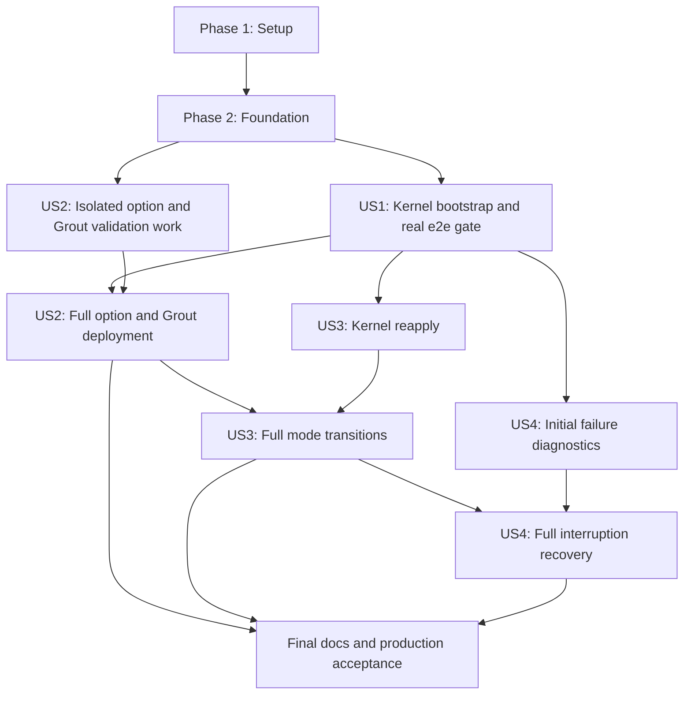

# Tasks: Image-Based Systemd Bootstrap

**Input**: Design documents in `specs/001-bootstrap-systemd/`.
**Prerequisites**: [plan.md](plan.md), [spec.md](spec.md), [research.md](research.md), [data-model.md](data-model.md), [contracts/](contracts/), and [quickstart.md](quickstart.md).
**Created**: 2026-11-05.

**Tests**: Explicitly required by FR-018/SC-007 and the user's instruction to perform a systemd deployment and run at least one test. Include meaningful contract, lifecycle, and real-host proof from the plan. Write relevant tests before their implementation and confirm they fail for the missing behavior; no test-only surrogate satisfies the runtime gate.

**Format**: `- [ ] TNNN [P?] [USn?] Description with exact repository-relative file paths`. `[P]` identifies independent file work after its stated prerequisites. Only user-story tasks carry story labels. New file paths below are intended implementation targets, not claims that files already exist.

**Implementation layout**: Bootstrap lifecycle and action planning are consolidated in `bootstrap.go`; immutable generation storage is in `store.go`. Option and Grout checks use the shared config, preflight, and renderer modules. The task paths below reflect these implementation choices. Runtime gates remain unchecked until executed.

**Execution boundary**: This document schedules implementation; it does not perform it. No runtime result is currently claimed. If creating a commit, use the writecommit skill. Follow AGENTS.md and CODING_STYLE.md. Environment deployments/tests use the required deploy/e2e/e2etriage skills.

## Phase 1: Setup (Shared Infrastructure)

**Purpose**: Prepare reusable topology inputs and a place to record actual implementation validation. Keep the current Go module and test frameworks; do not initialize another project.

### Setup tasks

- [x] T001 Add minimal valid kernel, Grout TAP, and Grout PCI YAML fixtures plus invalid-input fixtures in `internal/bootstrap/testdata/`, based on `contracts/configuration.md` and existing static API schemas; include explicit index zero, interface-derived index, inline routing, and external-directory examples.
- [x] T002 [P] Create `specs/001-bootstrap-systemd/validation.md` with unexecuted entries for image identity, deployment commands, node unit evidence, focused e2e executed/passed counts, report paths, and production kernel/TAP/PCI coverage; do not mark planning checks as runtime passes.

---

## Phase 2: Foundational (Blocking Prerequisites)

**Purpose**: Establish shared contracts and host operations before story integration. Complete this phase before any user-story implementation. Tests for these behaviors are written before the corresponding implementation within each task.

### Shared models and operations

- [x] T003 Define the package entry contract in `internal/bootstrap/bootstrap.go` and input, effective configuration, generation manifest, applied-state, transition, ownership-inventory, and result types in `internal/bootstrap/config.go` and `internal/bootstrap/state.go`; use presence-aware node index and separate published/activated state as specified in `data-model.md`.
- [x] T004 Implement strict version-one YAML decoding and domain validation in `internal/bootstrap/config.go` with table tests in `internal/bootstrap/config_test.go`; reject duplicate/unknown/null fields, invalid CRD ranges, explicit backoff zero, conflicting routing sources, and index/interface conflicts, and reuse static/conversion validators without silently filtering invalid resources.
- [x] T005 [P] Implement explicit host-root path resolution and bounded host command execution in `internal/bootstrap/host.go` with `internal/bootstrap/host_test.go`; resolve interface-based node identity in host networking, use argument arrays through nsenter, and reject escaping symlinks, traversal, and unit-value injection.
- [x] T006 [P] Implement nonblocking host locking and atomic protected JSON/generation metadata writes in `internal/bootstrap/state.go` with `internal/bootstrap/store_test.go`; preserve previous state on failed writes, exclude secrets from result metadata, and distinguish missing state from corrupt state.
- [x] T007 [P] Extend `internal/systemdctl/systemdctl.go` with context-bounded reload/start/stop/show operations and missing-unit classification needed by bootstrap; cover exact commands and cancellation in `internal/systemdctl/systemdctl_test.go` without changing existing controller restart behavior.
- [x] T008 Implement read-only host/image/ownership preflight in `internal/bootstrap/preflight.go` with `internal/bootstrap/preflight_test.go`: check cgroup/Quadlet capabilities, writable managed roots, local image IDs and packaged components, foreign unit/drop-in/enablement conflicts, config source permissions, and reserved namespace ownership; never pull images or mutate runtime services.

---

## Phase 3: User Story 1 - Bootstrap a Host from Configuration (Priority: P1, MVP)

**Goal**: Deploy the default kernel runtime from one image entry point and one enabled root unit, including offline static startup.

**Independent Test**: On fresh prepared development nodes, start only bootstrap, verify controller/FRR/reloader health and static routing without Kubernetes, then enable the existing hostbridge integration and execute the focused BGP restart-recovery e2e test. Only bootstrap is enabled; its process exits after success.

**Prerequisite**: Phase 2. This first deliverable uses default kernel deployment settings; non-default option coverage and Grout arrive in US2.

### Tests for User Story 1

- [x] T009 [P] [US1] Add deterministic kernel rendering and actual installed-generator tests in `internal/bootstrap/render_test.go`; prove expected pod/container/volume services, preserved names/PID path, symlink discovery with QUADLET_UNIT_DIRS, no install links, and no network-online/bootstrap ordering cycles.
- [x] T010 [P] [US1] Add successful first-apply and offline-start lifecycle tests in `internal/bootstrap/bootstrap_test.go`; require complete validation before publish, explicit startup of every required container unit, finite health waits, and bootstrap exit with runtime services still independently supervised.

### Implementation for User Story 1

- [x] T011 [US1] Implement deterministic default-kernel rendering in `internal/bootstrap/render.go` and `internal/bootstrap/templates/`; preserve existing pod/container/volume identities, namespace and FRR PID integration, remove explicit network-online and all Install sections, and set Quadlet DefaultDependencies=false while retaining ordinary systemd defaults.
- [x] T012 [US1] Implement stage/finalize/atomic-current publication and bootstrap-owned discovery registration in `internal/bootstrap/store.go`; keep persistent FRR/CNI/kubeconfig/startup-gate data outside generations, validate the installed generator before publication, and refuse foreign artifact adoption.
- [x] T013 [US1] Implement generated node/inline routing and direct external-directory mounts in `internal/bootstrap/render.go`; preserve existing static file schemas and live directory watching, render one effective node logLevel, and keep generated secrets out of unit lines.
- [x] T014 [P] [US1] Implement image-independent bounded HTTP health probing in `internal/bootstrap/probe.go` with `internal/bootstrap/probe_test.go`; generated checks must use `/bootstrap probe` rather than assume wget or curl exists.
- [x] T015 [US1] Implement the public validate/apply orchestration in `internal/bootstrap/bootstrap.go` including lifecycle operations: lock, host/image preflight, staged generator validation, atomic publication, host daemon-reload, full runtime activation and health, and sanitized outcome; enforce the 300-second default and 30–1800-second configurable deadline.
- [x] T016 [US1] Add validate/apply/probe argument parsing in `cmd/bootstrap/main.go` according to `contracts/lifecycle.md`; pass dependencies explicitly, report stage/cause with nonzero failures, keep environment access in main, and preserve the default controller image invocation.
- [x] T017 [US1] Build and copy `/bootstrap` and explicitly ensure nsenter availability in `Dockerfile` and `Dockerfile.grout`; include embedded templates through Go embedding and retain both existing ENTRYPOINT declarations.
- [x] T018 [US1] Install the contract unit as `systemdmode/openperouter-bootstrap.service` and add protected example YAML/environment files under `systemdmode/bootstrap/`; enable only bootstrap, use local images without host-root relabeling, and bound one-shot execution/cleanup.
- [x] T019 [US1] Update `systemdmode/deploy.sh`, `systemdmode/setup_node_config.sh`, and hostmode targets in `Makefile` to preload the feature image, prepare per-node bootstrap YAML, install/enable bootstrap, and collect result/unit failures; stop copying legacy Quadlets and preserve the static-before-Kubernetes deployment target.
- [x] T020 [US1] Update `systemdmode/verify-quadlets.sh` to verify generated service identities, full runtime member health, bootstrap active/exited state, no bootstrap container left running, and sole bootstrap enablement; remove systemctl-enable expectations for generated units.
- [ ] T021 [US1] Extend `e2etests/systemd_static_suite/systemd_static_files_test.go` and `e2etests/pkg/systemd/units.go` to require bootstrap-generated deployment evidence and prove static routing starts before hostbridge credentials; preserve existing route and live-reload assertions.
- [ ] T022 [US1] Use the deploy skill in hostmode to build and perform an actual bootstrap-based systemd deployment, then use the e2e-tests skill to run `Systemd Router Restart Resiliency.*recovers BGP sessions after FRR restart` from `e2etests/tests/systemd_resiliency.go` with --systemdmode and --fail-on-empty; record image ID, node bootstrap/runtime-unit evidence, exact commands, nonzero executed/passed counts, and e2e-report.json path in `specs/001-bootstrap-systemd/validation.md` (FR-018/SC-007).

**Checkpoint**: Kernel MVP includes an actual bootstrap deployment and passing focused e2e result (T022). It is not full Grout or lifecycle completion.

---

## Phase 4: User Story 2 - Configure Host Runtime Knobs (Priority: P1)

**Goal**: Apply all seven operator-compatible knobs, both node-index methods, and kernel/Grout TAP/PCI deployment settings consistently.

**Independent Test**: Bootstrap a prepared host with defaults and non-default values, inspect running arguments/mounts/health endpoints, and prove static packet forwarding for kernel, production TAP, and production PCI. Invalid settings and missing prerequisites must fail before managed runtime mutation.

**Prerequisite**: Phase 2 for isolated option/validation work; US1 renderer and runtime are required for end-to-end completion. US1 and US2 both have priority P1; do not call the entire feature complete after the kernel MVP.

### Tests for User Story 2

- [x] T023 [P] [US2] Add operator-CRD parity and effective-option tests in `internal/bootstrap/config_test.go` and `internal/bootstrap/render_test.go`, using `operator/config/crd/bases/network.openperouter.io_openperouters.yaml` as the constraint reference; cover all seven names/defaults, six log levels, both node methods, matching arguments/mounts/probes, and explicit rejection of the five Kubernetes-only fields.
- [x] T024 [P] [US2] Add Grout service-generation and prerequisite tests in `internal/bootstrap/preflight_test.go` and `internal/bootstrap/render_test.go`; cover TAP/PCI, compatible all-component image selection, FRR dplane_grout, shared socket, durable device-state mount, maxMTU/testMode semantics, and read-only checks for bifurcated/VFIO hardware and production resources.
- [x] T025 [P] [US2] Extend `internal/logging/logging_test.go` with behavioral tests for all enabling every supported verbosity, none suppressing runtime logs, and unchanged debug/info/warn/error behavior; keep bootstrap outcome reporting independent.

### Implementation for User Story 2

- [x] T026 [US2] Complete all/none support in `internal/logging/logging.go` using the existing logging API; do not normalize none to error or alter existing four-level behavior.
- [x] T027 [US2] Compute effective operator-compatible settings in `internal/bootstrap/config.go` and pass them into `internal/bootstrap/render.go`; propagate healthProbePort, bgpListenLimit, controllerMaxReconcileBackoffSeconds, logLevel, OVS socket/run directory, and datapath consistently, and omit backoff override when unset.
- [ ] T028 [US2] Implement Grout host/image/resource checks in `internal/bootstrap/preflight.go` and integrate them into `internal/bootstrap/preflight.go`; inspect selected devices and original driver/state without rebinding, distinguish bifurcated drivers from VFIO, and validate TUN, hugepages, permissions, socket access, and MTU requirements before publication.
- [x] T029 [US2] Render Grout service and mode-specific FRR/controller wiring in `internal/bootstrap/templates/grout.container.tmpl`, `internal/bootstrap/templates/daemons.tmpl`, and `internal/bootstrap/render.go`; use the compatible Grout image for all components, preserve chart sizing, and apply tapUnderlay/maxMTU/testMode explicitly.
- [x] T030 [US2] Render durable host `/var/lib/openperouter/grout/device-state` at existing controller `/var/run/grout/device-state` and shared runtime socket mounts in `internal/bootstrap/render.go`; keep device records outside immutable generations and distinct from ephemeral socket state.
- [x] T031 [US2] Add Grout control readiness and startup ordering to `internal/bootstrap/bootstrap.go` and `internal/bootstrap/probe.go`; retain the old router pod/namespace/PID contract and require all selected runtime services to become healthy before success.
- [x] T032 [US2] Add a combined hostmode+Grout build/deployment lane in `Makefile` and `systemdmode/deploy.sh`, and document it in `.agents/skills/deploy/SKILL.md`; supply Grout YAML/image without substituting the Kubernetes-only grout deployment target.
- [x] T033 [US2] Update `.agents/skills/e2e-tests/SKILL.md` and `e2etests/pkg/systemd/units.go` so combined hostmode+Grout detection supplies both test flags and one compatible label filter; preserve kernel hostmode behavior and report real cluster lookup failures.
- [ ] T034 [US2] Extend bootstrap option and production-forwarding scenarios in `e2etests/systemd_static_suite/systemd_static_files_test.go`; execute default/non-default and kernel/Grout TAP/PCI checks through the deploy/e2e skills, record exact settings and packet proof in `specs/001-bootstrap-systemd/validation.md`, and leave unavailable hardware evidence explicitly incomplete rather than replace it with testMode smoke results.

**Checkpoint**: All declared deployment knobs and both Grout underlay modes are implemented; production modes require their own recorded runtime proof.

---

## Phase 5: User Story 3 - Reapply Configuration Safely (Priority: P2)

**Goal**: Leave healthy unchanged services untouched, update affected settings/images only, and restore devices safely during datapath/TAP/PCI changes.

**Independent Test**: Reapply unchanged input/images three times and compare content, invocation IDs, restart counters, and resource identities; then change one option/image and verify the affected services. Exercise owned-mode transitions and preservation of unrelated objects on disposable hosts.

**Prerequisite**: US1 for kernel reapply; US2 for complete datapath/mode-transition validation. Pure fingerprint/action-planning tests can run without a live cluster.

### Tests for User Story 3

- [ ] T035 [P] [US3] Add per-component fingerprint/action-planning tests in `internal/bootstrap/reapply_test.go`; cover identical input, local mutable-tag ID changes, generated-node/inline changes, unchanged external-directory identity, failed/inactive units with identical content, and removed services.
- [ ] T036 [P] [US3] Add mode-transition and ownership tests in `internal/bootstrap/transition_test.go`; cover kernel-to-Grout, Grout-to-kernel, TAP-to-PCI, PCI-to-TAP, missing previous image/inventory, cleanup failure propagation, and foreign namespace/device/OVS objects.

### Implementation for User Story 3

- [ ] T037 [US3] Implement canonical generation/component fingerprints and observed-runtime action planning in `internal/bootstrap/reapply.go`; resolve local image IDs, ignore diagnostic timestamps and live external routing file contents, and restart the controller for changed generated config or routing source even when unit bytes match.
- [ ] T038 [US3] Add exact managed network ownership inventory updates in `internal/controller/routerconfiguration/host_config.go`, `internal/controller/routerconfiguration/grout_config.go`, and `internal/controller/routerconfiguration/inventory.go`; persist hostmode static and later API-managed resources for bootstrap cleanup without treating naming coincidence as ownership.
- [ ] T039 [US3] Add focused ownership-aware teardown composition in `internal/bootstrap/teardown.go`, adapting `internal/grout/underlay.go`, `internal/hostnetwork/underlay.go`, and VNI/VRF cleanup APIs only where selection is required; reuse restoration primitives, initialize CNI cleanup, preserve administrator bridges/unowned links, and propagate every cleanup failure.
- [ ] T040 [US3] Implement durable old-mode transition orchestration in `internal/bootstrap/transition.go`: retain prior image/inventory, persist intent before stop, stop old controller and FRR/reloader, retain namespace/old Grout through restoration, remove device records only after success, and never delete the namespace as a shortcut.
- [ ] T041 [US3] Wire the internal previous-image teardown command in `cmd/bootstrap/main.go` according to `contracts/lifecycle.md`; validate transition identity and active parent lock owner, avoid a second lock acquisition, and reject arbitrary cleanup targets.
- [ ] T042 [US3] Integrate action planning and transitions into `internal/bootstrap/bootstrap.go`; publish only complete generations, stop obsolete owned components, reload once as needed, restart changed members in dependency order, repair inactive/failed units, and record published versus activated state without restarting healthy matching services.
- [ ] T043 [US3] Add and execute repeatability, image/setting update, and external-file hot-reload cases in `e2etests/systemd_static_suite/bootstrap_reapply_test.go`; record three unchanged applies with zero healthy-service restarts and the affected-only update evidence in `specs/001-bootstrap-systemd/validation.md`.
- [ ] T044 [US3] Add and execute disposable-host mode-switch acceptance in `e2etests/systemd_static_suite/bootstrap_transition_test.go`; verify all four mode directions, original driver/address restoration, target forwarding, and preservation of foreign objects, recording actual kernel/TAP/PCI evidence in `specs/001-bootstrap-systemd/validation.md`.

**Checkpoint**: Reapplication is idempotent and mode changes restore owned devices before activating target configuration.

---

## Phase 6: User Story 4 - Diagnose and Recover from Failure (Priority: P2)

**Goal**: Report actionable sanitized failures and recover from partial publication/activation/restoration by one corrected retry.

**Independent Test**: Inject invalid input, missing prerequisites, file-write failures, lock conflicts, startup failures, and interrupted restoration; verify mutation boundaries, exact failed stage, affected-service diagnostics, and successful retry without duplicate resources or manual cleanup.

**Prerequisite**: US1 for initial failure scenarios and US3 for transition recovery. Minimal failure handling is already required by earlier stories; this phase completes the full diagnostic and interruption matrix.

### Tests for User Story 4

- [ ] T045 [P] [US4] Add lifecycle failure-injection tests in `internal/bootstrap/recovery_test.go`; fail staging, finalization, current-pointer replacement, discovery registration, reload, start, health, and transition restoration, and assert no partial artifact activation or loss of previous-image/device records.
- [ ] T046 [P] [US4] Add result/CLI tests in `internal/bootstrap/result_test.go` and `cmd/bootstrap/main_test.go`; require nonzero failures, stage/path/service identification, changed-service inventory, secret redaction, concurrent-lock failure, and bounded startup-gate timeout.

### Implementation for User Story 4

- [ ] T047 [US4] Complete sanitized atomic outcomes in `internal/bootstrap/result.go` and `cmd/bootstrap/main.go`; distinguish input/render/publication/activation/restoration failures, preserve relevant diagnostics, and report bootstrap failures even when runtime logLevel is none.
- [ ] T048 [US4] Implement interruption-aware recovery in `internal/bootstrap/recovery.go` and integrate `internal/bootstrap/bootstrap.go`; reconcile current/applied/transition state against observed runtime, resume old-mode restoration before target activation, retry failed matching-content services, and preserve every recovery-referenced generation/image.
- [ ] T049 [US4] Propagate deadline/cancellation through `internal/bootstrap/host.go`, `internal/bootstrap/bootstrap.go`, and `internal/bootstrap/transition.go`; terminate bounded host jobs, release the parent lock, retain resumable restoration metadata, and prevent late target activation after timeout.
- [ ] T050 [US4] Add and execute host failure/retry scenarios in `e2etests/systemd_static_suite/bootstrap_recovery_test.go`, including invalid-input no-mutation, missing images, foreign-unit conflicts, startup-gate deadline, service startup failure, and interrupted restoration; record one corrected successful retry per case in `specs/001-bootstrap-systemd/validation.md`.

**Checkpoint**: A corrected retry repairs every tested partial failure without manual cleanup; automatic service rollback remains outside scope.

---

## Phase 7: Polish & Cross-Cutting Validation

**Purpose**: Finish user documentation and run required repository and real-host acceptance gates. This phase does not replace the early US1 deployment/e2e gate. Do not claim all modes complete when hardware validation is unavailable.

### Completion tasks

- [x] T051 [P] Update `website/content/docs/installation/systemd-mode.md` with prerequisites, image preparation, initial bootstrap-unit installation, sole bootstrap enablement, explicit legacy-unit migration/conflicts, first-run verification, and failure recovery.
- [x] T052 [P] Update `website/content/docs/configuration/systemd-mode.md` with YAML examples, seven CRD mappings/defaults, rejected Kubernetes fields, inline versus live external routing, index-zero/interface behavior, Grout TAP/PCI/maxMTU/testMode, startup deadlines, reapplication, and disruptive mode-transition expectations.
- [ ] T053 Add actual offline reboot orchestration and evidence capture in `systemdmode/verify-bootstrap-boot.sh` with assertions in `e2etests/systemd_static_suite/bootstrap_boot_test.go`; execute three true host/node reboots per production lane with preloaded images and Kubernetes/registry unavailable, recording host identity changes and static forwarding recovery in `specs/001-bootstrap-systemd/validation.md`.
- [ ] T054 Run `make test` and `make lint` as required by `CODING_STYLE.md` and the project workflow, correct task-related failures, and record exact commands/results in `specs/001-bootstrap-systemd/validation.md`; repeat only after relevant changes or failures.
- [ ] T055 Use deploy/e2e skills to rerun the final bootstrap-based systemd deployment and focused nonempty passing BGP restart test after implementation changes, following `specs/001-bootstrap-systemd/quickstart.md`; retain image IDs, node-unit proof, executed/passed counts, and report artifact paths in `specs/001-bootstrap-systemd/validation.md` and use e2etriage on failures.
- [ ] T056 Review `specs/001-bootstrap-systemd/validation.md` against every FR-001–FR-018 and SC-001–SC-007 acceptance condition; verify documented quickstart commands, classify genuinely unexecuted hardware checks explicitly, and mark task completion only from recorded results rather than mocks or skipped tests.

---

## Dependencies & Execution Order

### Phase and story graph

### Concrete prerequisites

- Setup fixtures and the evidence record precede Foundation. Complete T003 and T004 before the independent host/state/systemd tasks; finish all Foundation tasks before story integration.
- US1 tests precede rendering/apply implementation. T011 precedes T012 and T013; T015 requires renderer, publication, host operations, and probe. CLI/image/unit integration precedes deployment and the actual e2e gate T022.
- US2 isolated tests/logging can start once Foundation is ready; option propagation and Grout runtime integration require US1 renderer/apply. T028 precedes T034; compatible packaging, Grout wiring/state/health, and combined deploy/test selection must all finish before claiming either Grout lane passes.
- US3 fingerprint tests can start after US1. Ownership inventory T038 and targeted cleanup T039 precede transition orchestration T040; previous-image CLI wiring and all of those precede integrated reapply T042. Hardware transitions require the US2 production prerequisites.
- US4 failure tests follow initial lifecycle contracts; full recovery T048 requires durable transition state from US3. Failure tests are written before recovery implementation and run again afterward.
- Documentation tasks can overlap after contracts stabilize. Offline, repository, and final e2e gates depend on integrated runtime behavior. The final audit follows all execution evidence; hardware-unavailable checks remain unfinished.

### File ownership and parallel opportunities

`[P]` is permission to work on distinct files within the indicated ready batch, not permission to ignore earlier phase prerequisites. Do not run deployments, unit-changing checks, or hardware tests concurrently on the same host. Shared `apply.go`, `render.go`, CLI, Makefile, and deployment-script changes are sequential integration points; US labels alone do not make them parallel-safe.

Foundation example after T004: T005, T006, and T007 can proceed together in distinct files. Documentation example after contracts stabilize: T051 and T052 can proceed together.

## Parallel Examples by User Story

- **US1**: Write T009 (`internal/bootstrap/render_test.go`, `internal/bootstrap/render_test.go`) alongside T010 (`internal/bootstrap/bootstrap_test.go`) after Foundation. After render/publication contracts stabilize, the probe module T014 can proceed independently before the common apply integration.
- **US2**: Write T023, T024, and T025 together in separate test files after Foundation. Serialize subsequent shared render/apply changes; do not parallelize Grout deployment against kernel validation on the same cluster.
- **US3**: Write T035 and T036 together after the respective lifecycle types are available. Integrate inventory, teardown, and action planning in dependency order rather than edit shared controller files concurrently.
- **US4**: Write T045 and T046 together after existing lifecycle/transition interfaces stabilize. Run recovery mutation tests in isolated temporary roots; real-host failure injection remains sequential.

## Requirement and Contract Coverage

| Requirements/outcomes | Primary tasks |
|-----------------------|---------------|
| FR-001, FR-002, FR-004, FR-009; SC-001 | T011–T020 |
| FR-003, FR-007, FR-015; static-before-Kubernetes and live reload | T004, T013, T021, T043 |
| FR-005, FR-006, FR-017; SC-002 | T023–T034 |
| FR-008, FR-012; ownership and host prerequisites | T005, T008, T028, T038, T039 |
| FR-010; SC-004 offline reboot proof | T009, T021, T053 |
| FR-011; SC-003 repeatability and updates | T035–T044 |
| FR-013, FR-014; SC-005, SC-006 recovery | T006, T045–T050 |
| FR-016 documentation | T051, T052 |
| FR-018; SC-007 real deployment and nonempty passing test | T019, T022, T055, T056 |
| configuration.md contract | T003, T004, T023, T024 |
| lifecycle.md command/state contract | T005, T006, T016, T040, T041, T047, T048 |
| openperouter-bootstrap.service contract | T018, T020, T022 |

## Implementation Strategy

1. Complete Setup/Foundation, then ship the default-kernel US1 slice. The MVP includes the real deployment and passing recovery test; generation-only output is insufficient.
2. Add US2 knobs and production Grout TAP/PCI support. Keep testMode smoke proof separate from production forwarding evidence.
3. Complete US3 idempotence, affected-only updates, and ownership-aware mode transitions. Add US4 interruption recovery and sanitized diagnostics without removing earlier fail-before-mutation guarantees.
4. Finish docs and execute the full host acceptance matrix. Preserve user-required early runtime proof and rerun the focused gate after relevant final changes. Hardware availability limits verification, not required scope.
5. Stop this generation command after writing tasks. Next command is `speckit-implement`; do not mark implementation tasks complete during planning.

## Task Summary

| Area | Tasks |
|------|-------|
| Setup/Foundation/Polish | 14 |
| US1 | 14 |
| US2 | 12 |
| US3 | 10 |
| US4 | 6 |
| Total | 56 |

16 tasks have `[P]` markers, grouped into the ready batches described above. Every task has a sequential ID, checkbox, required story label where applicable, and concrete file paths. No extension pre/post hooks are configured (`.specify/extensions.yml` absent).
